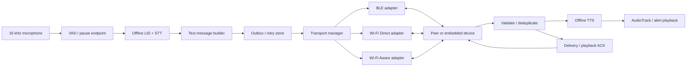

# Text-First Offline Speech Transmission Pipeline

Status: compiled and one-phone runtime-checked Wi-Fi Direct/Bluetooth Android prototype; no two-phone radio results are claimed yet  
Target: low/mid-range Android phones and optional embedded relays  
Scope: 10-language offline STT → compact text transport → offline TTS

## 1. Problem statement, interpreted correctly

The supplied problem statement is not asking us to transmit raw speech efficiently. It asks each sender to run speech recognition locally, transmit the resulting text over Wi-Fi or Bluetooth, and reconstruct intelligible speech locally on the receiver.

That changes the architecture completely:

```text
microphone → VAD/endpointer → local STT → compact text message
           → Bluetooth/Wi-Fi → local TTS → speaker/alert
```

The required path is a direct two-phone walkie-talkie/phone demonstration. Embedded-device support is also in scope. Multi-hop delay-tolerant routing is a useful disaster-resilience extension, but it is not required to prove the primary loop and cannot replace a low-latency direct connection.

### Evaluation ownership

| Metric | Pipeline responsibility |
|---|---|
| Efficiency, 20% | STT/TTS model and APK size, peak/idle RAM, idle CPU, radio/discovery power, bytes per message |
| Accuracy, 40% | STT WER/CER per language and TTS intelligibility/flow on real speakers |
| Latency, 20% | speech-end→STT-final, transmit, receive→TTS-ready, playback-start, end-to-end, and RTF |
| Offline/open-source | no hosted API; every bundled model/library has a recorded license and source |
| Deployability | the same APK must work on actual low/mid-range phones, not only desktop/Kaggle |

## 2. Architectural verdict

Build one transport-independent binary message protocol and three native transport adapters:

1. **BLE** for the lowest-power, universally small text path and embedded devices.
2. **Wi-Fi Direct** for broadly supported phone-to-phone high-throughput direct sessions.
3. **Wi-Fi Aware/NAN** as the best direct Wi-Fi path when both devices expose it.

Use BLE discovery/control to negotiate an optional Wi-Fi upgrade only after the baseline works. Keep one active data path per session; racing and bonding multiple paths is not necessary for the first reliable build.

Do **not** base the judged open-source build on Google Nearby Connections. Its convenience is real, but the Android runtime is supplied through Google Play Services, and the published security analysis describes the implementation as proprietary, closed-source, and obfuscated ([NDSS 2019](https://www.ndss-symposium.org/ndss-paper/nearby-threats-reversing-analyzing-and-attacking-googles-nearby-connections-on-android/)). Google’s setup guide also explicitly requires the [Google Play Services SDK](https://developers.google.com/nearby/connections/android/get-started). That creates an avoidable compliance and non-GMS-device risk.

### Audit of the proposed research ideas

| Proposal | Verdict |
|---|---|
| Text instead of audio | **Keep.** This is the PS’s central bandwidth reduction. |
| Binary framing and MTU-aware fragmentation | **Keep.** Use the common envelope and adapter-specific framing below. |
| Nearby Connections | **Exclude from judged core.** Closed-source Play Services runtime conflicts with the safest reading of the restriction. |
| Epidemic routing | **Keep as optional Phase 2.** Good small-node DTN baseline, not needed for the direct loop. |
| PRoPHET/hybrid | **Benchmark later.** More state and tuning; not automatically better for four demo nodes. |
| Replace PRoPHET with a Hopfield network | **Reject.** The analogy does not establish routing correctness or convergence. |
| Wi-Fi RTT routing | **Experimental only.** It ranges a visible peer, not an unseen destination. |
| Reed–Solomon on every message | **Defer.** Wrong default for reliable BLE/TCP links; test only on a lossy datagram leg. |
| `lwfec` as MIT | **Correct.** The repository declares GPLv3. |
| Four-timestamp clock sync | **Keep for metrics.** Measure residual error on the actual phones. |
| Alert intent-code fallback | **Keep with safeguards.** Send it first for critical alerts, but never silently discard the full transcript. |
| F0/prosody payload on every message | **Defer.** Ship punctuation/text first; require a listening-test gain before spending bytes/complexity. |

### End-to-end architecture



## 3. What exists in this repository

The primary Android app already contains:

- 16 kHz mono capture with sample-rate fallback/resampling;
- pause-based VAD segmentation;
- offline English/Indic STT routing;
- bounded STT work so segments do not grow without limit;
- Android `TextToSpeech` playback of a completed transcript;
- per-segment STT timing logs.

The original missing judged loop was:

`STT result → message envelope → peer connection → receiver validation → receiver TTS → playback ACK → cross-device timing report`.

The first implementation now covers that loop through native Wi-Fi Direct discovery and a length-prefixed TCP connection over the infrastructure-free group. It includes the binary envelope, ten-language critical-field detection, alert-core/transcript/repair ordering, automatic receiver TTS, received/playback ACKs, and a repair request when a critical field falls below the provisional confidence threshold. Manual IP remains a diagnostic fallback. The code compiles and its protocol/loopback tests pass, but the Wi-Fi Direct radio path is not yet a measured two-phone result.

Two current limitations must be stated honestly:

1. Existing desktop ASR timings are not phone timings. The local patched Indic ONNX model also uses float convolution replacements, so its desktop result is not evidence of an efficient mobile INT8 deployment.
2. Android’s installed offline `TextToSpeech` voices are device-dependent and their model licenses are not controlled by this APK. For strict “open-source only” compliance and reproducible TTS accuracy, bundle a verified open-source TTS model/voice set or obtain written organizer confirmation that system TTS is acceptable.

## 4. Required interaction modes

### Push-to-talk mode

1. User presses and holds PTT.
2. Capture and VAD run locally.
3. Release or a configured terminal pause closes the utterance.
4. STT produces finalized text and language.
5. Sender immediately transmits a `TEXT_FINAL` or `ALERT` message.
6. Receiver validates, queues, and synthesizes the text.
7. Playback starts; receiver returns `PLAYBACK_STARTED` and later `PLAYBACK_FINISHED` ACKs.

This is the first deliverable because it has deterministic turns and no acoustic echo loop.

### Continuous “phone” mode

Do not wait for an indefinitely long sentence. VAD closes short clauses; each finalized clause receives an increasing utterance sequence and is sent immediately. The receiver can synthesize clause N while the sender records clause N+1.

True simultaneous two-way use introduces an echo problem: received TTS audio can re-enter the microphone and be transcribed again. Use Android’s platform `AcousticEchoCanceler` where available and a voice-communication audio source. On devices where AEC is unavailable or fails the echo test, fall back to controlled half-duplex turn-taking. Never claim full-duplex phone behavior merely because two threads can run.

### Alert mode

An alert message contains both a language-independent alert code and, when available, the full recognized text. Send the small alert code first, then the full text. The receiver can immediately speak a locally stored/synthesized template in its preferred language and then speak the detailed message.

Use `AudioAttributes.USAGE_ALARM` and request appropriate transient audio focus. Android defines alarm usage, but focus may be delayed or denied by the system ([Audio attributes](https://developer.android.com/reference/android/media/AudioAttributes#USAGE_ALARM), [audio focus](https://developer.android.com/reference/android/media/AudioFocusRequest)). A normal third-party app cannot honestly guarantee “highest volume, non-interruptible” against user volume, Do Not Disturb, phone calls, policy, or hardware mute. The UI must ask the user to enable the required alert/DND access and visibly report when the guarantee is unavailable.

## 5. Multi-transport design

All adapters expose the same small contract:

```text
discover() / advertise()
connect(peer)
send(messageBytes)
receive() -> messageBytes
linkStats() -> mtu, rssi/quality, tx/rx bytes, failures
close()
```

The contract is a design boundary, not a request for three implementations on day one. Implement and measure one phone-to-phone adapter first, then reuse the exact message fixtures for the others.

### Transport selection

| Path | Use | Strength | Limitation |
|---|---|---|---|
| BLE GATT | API 26 baseline and most embedded peers | low power; sufficient for small text | manual fragmentation and flow control |
| BLE L2CAP CoC | API 29+ BLE peer path | stream semantics and credit flow control | not available through public API on API 26–28; embedded support varies |
| Wi-Fi Direct | primary direct phone-to-phone option | broad Android support; ordinary sockets | group setup/power cost; OEM behavior varies |
| Wi-Fi Aware | preferred when both phones support it | infrastructure-free bidirectional data path | optional hardware feature; runtime capability check required |
| ESP-NOW | future embedded-to-embedded relay leg | connectionless local transport | Android phones cannot directly use ESP-NOW through standard app APIs |

Android documents that [Wi-Fi Direct](https://developer.android.com/develop/connectivity/wifi/wifip2p) connects devices without an access point and transfers data through sockets. [Wi-Fi Aware](https://developer.android.com/develop/connectivity/wifi/wifi-aware) provides infrastructure-free discovery plus a bidirectional network data path on supported API 26+ devices. Support is optional, so test `FEATURE_WIFI_AWARE` rather than assuming it.

### Session policy

1. User explicitly selects a known peer or confirms a short authentication code.
2. Exchange protocol version, supported transports, maximum message size, language set, and alert capability.
3. Auto mode chooses Aware → Wi-Fi Direct → BLE from the mutually supported set; manual mode lets the judge select Wi-Fi or Bluetooth.
4. Keep the session warm while in PTT/phone mode so discovery/setup time is not paid per sentence.
5. If Wi-Fi fails, reconnect over BLE and resend unacknowledged messages by message ID.

This is failover, not simultaneous multipath. Add bonded multipath only if measurements later show that reconnect latency is a real failure mode.

## 6. Compact message wire format

Do not send JSON. Use a fixed binary base header, optional typed extensions, UTF-8 payload, and a trailing integrity value. A six-byte total header is not sufficient once message identity, source/destination, deduplication, length, routing, and integrity are included.

### Base envelope

| Offset | Bytes | Field |
|---:|---:|---|
| 0 | 2 | Magic `0x53 0x54` (`ST`) |
| 2 | 1 | Protocol version |
| 3 | 1 | Message type |
| 4 | 2 | Flags |
| 6 | 1 | Language code |
| 7 | 1 | Header length, including extensions |
| 8 | 16 | Random message ID |
| 24 | 8 | Source terminal ID |
| 32 | 8 | Destination terminal ID or broadcast value |
| 40 | 4 | Payload length, unsigned big-endian |
| 44 | variable | Optional header TLVs |
| ... | variable | UTF-8/binary payload |
| end−4 | 4 | CRC-32 over header and payload |

The fixed portion is 44 bytes; the CRC is another 4 bytes. A representative 150-byte transcript therefore occupies about 198 bytes before optional security metadata—still tiny relative to audio.

### Message types

| Type | Purpose |
|---|---|
| `HELLO`, `HELLO_ACK` | capability/session negotiation |
| `TEXT_FINAL` | complete finalized clause/utterance |
| `ALERT` | compact alert code plus optional full text/location |
| `RECEIVED_ACK` | receiver durably accepted a message |
| `PLAYBACK_STARTED` | TTS playback began |
| `PLAYBACK_FINISHED` | TTS playback completed |
| `SYNC_REQ`, `SYNC_RESP` | benchmark clock-offset exchange |
| `MANIFEST`, `ROUTE_OFFER` | optional DTN/relay extension |

### Language codes

Use one byte and freeze the mapping in protocol version 1:

`0=en, 1=hi, 2=gu, 3=mr, 4=kn, 5=ml, 6=ta, 7=te, 8=or, 9=bn, 255=undetermined`.

The sender supplies the detected language. The receiver does not rerun LID and invokes the matching TTS voice/model directly.

### Optional TLVs

Only send fields that have a consumer:

- utterance sequence and segment-final flag;
- sender monotonic transmit timestamp for metrics;
- STT confidence, quantized to one byte;
- alert code and optional location;
- DTN remaining TTL, hop limit, and copy count;
- end-to-end encryption metadata for relayed messages.

Do not send a 1–2 KB F0 contour by default. Punctuation, language, and short pause/emphasis markers are cheaper and more likely to be consumed by mobile TTS. Add measured prosody transfer only after an A/B listening test proves improved intelligibility or flow.

## 7. Framing by transport

### Wi-Fi Direct/Aware sockets

Use a TCP socket for the first build:

`4-byte frame length → exact envelope bytes`

TCP already supplies ordered reliable bytes. Keep application ACKs because `PLAYBACK_STARTED` is a semantic event TCP cannot report. UDP/FEC is not needed for a few hundred bytes unless measured TCP head-of-line delay becomes a demonstrated problem.

### BLE L2CAP CoC

Use the same four-byte length prefix over the secure stream. Android’s public LE CoC client/server APIs begin at API 29.

### BLE GATT

Fragment only at the adapter boundary. Each characteristic payload starts with:

| Bytes | Field |
|---:|---|
| 2 | session-local transfer ID |
| 1 | fragment index |
| 1 | fragment count |
| 2 | fragment CRC-16 |
| remaining | envelope bytes |

Infer fragment length from the characteristic value. Reassemble by transfer ID, reject duplicate/out-of-range fragments, enforce the declared maximum envelope size before allocating, and ACK only after the whole envelope passes CRC-32.

Never hard-code “512-byte Android MTU.” The default ATT MTU is small; the negotiated value is device dependent. Android 14 requests 517 when the first GATT client calls `requestMtu()`, but the effective value still depends on negotiation and the remote peer ([`BluetoothGatt.requestMtu`](https://developer.android.com/reference/android/bluetooth/BluetoothGatt#requestMtu(int))). Derive each fragment’s capacity from the actual callback and operation overhead.

### ESP-NOW bridge

Treat ESP-NOW as an embedded adapter, not a phone transport. Espressif documents 250-byte v1 and 1470-byte v2 limits plus CCMP link protection ([ESP-IDF ESP-NOW](https://docs.espressif.com/projects/esp-idf/en/latest/esp32/api-reference/network/esp_now.html)). Keep packets at or below 250 bytes when v1/v2 interoperability matters and fragment the same envelope above the selected payload limit.

## 8. Reliability, deduplication, and adaptive fidelity

### Direct-link reliability

- Persist the outgoing envelope until `RECEIVED_ACK` or expiry.
- Retry with the same message ID after reconnect; never synthesize duplicates.
- Receiver keeps a bounded recent-ID cache and a small durable receipt ledger.
- Use exponential retry backoff with a hard deadline for ordinary text.
- Alerts retry more aggressively and surface delivery state to the sender.

### Adaptive fidelity

The full transcript is already small. Do not silently replace arbitrary speech with a guessed intent just because RSSI fell.

For critical alerts only:

1. send `ALERT(code, optional location)` first;
2. send full UTF-8 transcript second;
3. resend the full transcript when the link recovers.

Suggested language-independent alert codes: medical, trapped, evacuate, safe, supplies, fire. The receiver maps the code to an audited local phrase in its preferred language. This is a resilient alert fast path, not machine translation and not a substitute for STT accuracy.

Represent location, if explicitly permitted, as two signed 32-bit fixed-point coordinates (8 bytes), not an unexplained four-byte “GPS” field. Location is optional because the PS does not require it and Android permissions/privacy must be handled.

### Compression reality

16 kHz mono PCM16 costs 32,000 bytes/s: 5–10 seconds is 160–320 KB. Even AMR-WB at 12.65 kbit/s is about 7.9–15.8 KB for 5–10 seconds. A 150-byte transcript plus the 48-byte base/integrity overhead is about 198 bytes. Text-first transmission therefore saves roughly 40–80× versus that compressed audio example and over 800× versus raw PCM.

The tradeoff is semantic: transmission cannot recover words the STT got wrong. That is why real multilingual WER/CER remains the largest evaluation item.

## 9. Forward error correction: where it belongs

Do not add Reed–Solomon to the BLE/Wi-Fi TCP baseline. BLE and Wi-Fi frames already perform link integrity checks and retries; TCP exposes losses as missing bytes, not random corrupt bytes. Application ACK/retry is simpler and protects the actual judged semantics.

FEC becomes reasonable only for a measured lossy datagram or ESP-NOW leg where:

- packet erasures are visible;
- retry RTT materially harms the alert deadline;
- the measured delivery gain exceeds parity, CPU, and battery cost.

Benchmark no-FEC, retry-only, and packet-erasure FEC under controlled loss before selecting it. `RS(220,200)` can correct ten unknown byte errors mathematically, but that is not automatically the channel error model.

The proposed [`lwfec`](https://github.com/sq8vps/lwfec) library is **GPLv3, not MIT**. It can only be adopted after the project chooses a compatible distribution license and validates its JNI/thread-safety behavior. It is not a baseline dependency.

## 10. Optional delay-tolerant relay/mesh

The practical extension is an application-layer Delay-Tolerant Network (DTN): store, carry, and forward complete text envelopes when devices encounter one another. It is not a continuously connected IP mesh and cannot promise phone-call latency while no path exists.

### Phase 1: bounded epidemic routing

For four to eight demo nodes:

1. Each node stores envelopes keyed by random message ID.
2. On contact, peers exchange sorted manifests of held IDs and delivery receipts.
3. Each requests missing, unexpired messages within its storage/copy budget.
4. Decrement `hop_limit` on forwarding; reduce remaining TTL by the local monotonic time held.
5. Destination returns a delivery/playback receipt; receipts propagate and suppress later copies.
6. Drop expired messages, oldest low-priority messages, then excess copies; retain alerts longest.

Do not “decrement TTL on contact.” Time TTL decreases with elapsed time; hop limit decreases per forwarding event. Keep the message store bounded so an epidemic demo cannot fill flash or drain the battery.

This follows the original [Epidemic Routing](https://cseweb.ucsd.edu/~vahdat/papers/epidemic.pdf) summary-vector idea, but adds the limits a phone implementation needs.

### Phase 2: PRoPHET only after a baseline

PRoPHET maintains a delivery-predictability value per known destination, updates it from encounters/transitivity, ages it over time, and prefers peers with higher predictability. The protocol is documented in [RFC 6693](https://www.rfc-editor.org/rfc/rfc6693.html). Han and Chung’s [hybrid PRoPHET paper](https://pmc.ncbi.nlm.nih.gov/articles/PMC4306380/) uses epidemic dissemination while forwarding/hop counters are within thresholds, then applies PRoPHET decisions.

Do not label PRoPHET or the hybrid “better” until the same mobility trace shows higher delivery ratio or lower delay at acceptable overhead. Compare at least:

- direct-only;
- bounded epidemic;
- Spray-and-Wait or copy-limited epidemic;
- PRoPHET;
- threshold hybrid.

The 2026 Hachijojima [tsunami-evacuation preprint](https://arxiv.org/abs/2601.00109) is a relevant scenario reference, not validation of this implementation.

### Claims not to make

- PRoPHET is not a Hopfield network, and replacing it with one has no demonstrated correctness or convergence benefit here.
- Android Nearby Connections is direct connectivity, not automatic application-level store-and-forward routing.
- Wi-Fi Aware forms system-managed NAN clusters, but the app still receives peer data paths; Android does not hand the app a complete multi-hop mesh router.
- A three-node relay demo must verify that A and C truly lack a direct path. Standing farther apart indoors is not proof.

## 11. Wi-Fi RTT: useful, but not a routing oracle

Android’s [`WifiRttManager`](https://developer.android.com/reference/android/net/wifi/rtt/WifiRttManager) can range RTT-capable access points and Wi-Fi Aware peers on supported API 28+ devices. It measures the distance to the **currently rangeable peer**. That may help contact characterization or discovery geofencing.

It does not tell relay B how close it is to an out-of-range destination C. Therefore, “choose the physically closest relay to the destination” is valid only if destination coordinates/ranges are actually known and fresh. Keep RTT out of Phase 1 routing; add it as an experimental PRoPHET feature only after capability, energy cost, and delivery impact are measured.

## 12. Security model

### Direct phone/embedded link

- Require Bluetooth bonding or a protected Wi-Fi Direct/Aware data path.
- On Wi-Fi sockets, use TLS and derive the displayed short authentication string from the authenticated peer/session transcript; user comparison must be cryptographically bound to the channel.
- A BLE-only prototype may rely on bonding for the judged local demo, but must be labelled as link-secured rather than field-secure until application-layer authenticated encryption is added.
- Reject unknown protocol versions, oversized lengths, invalid fragments, bad CRCs, and replayed message IDs before allocation or TTS.
- Treat received text as untrusted data; never interpret it as a URI, command, filename, or markup without validation.
- Keep contact IDs pseudonymous in advertisements.

Android explicitly warns that BLE data can be accessible to other apps on the device and recommends application-layer protection for sensitive data ([BLE overview](https://developer.android.com/develop/connectivity/bluetooth/ble/ble-overview)). Link security alone is therefore not an end-to-end disaster deployment security story.

### Relayed messages

Relays should be able to route without reading or altering the transcript. Use a vetted open-source cryptographic library for authenticated key agreement and AEAD; do not invent a PSK/HMAC protocol. A fresh value derived during a session is a session key, not a “fresh PSK.” Authenticate immutable source/destination/message metadata with the ciphertext; keep mutable hop/TTL fields in a separately validated routing extension.

Key provisioning, recovery, relay authorization, and compromise handling require a separate threat model before field deployment. The demo may use pre-enrolled device identities but must say so.

## 13. Cross-device clock synchronization

Separate application performance timestamps from wall-clock display time. Use `SystemClock.elapsedRealtimeNanos()` for local intervals.

For A/B offset estimation, exchange four timestamps:

```text
A sends request at t1
B receives at t2
B sends response at t3
A receives at t4

offset(B − A) = ((t2 − t1) + (t3 − t4)) / 2
network RTT     = (t4 − t1) − (t3 − t2)
```

Collect at least 20 exchanges, discard failed/outlier samples, and estimate offset from the lowest-RTT subset. Repeat at session start and immediately before/after a benchmark; move to a fixed 60-second resync only after measured drift justifies it.

Prior Android work demonstrated that PTP-style synchronization is feasible on phones, and a newer smartphone-sensor system reports 60 µs synchronization in its own UDP/server setup ([Hsu et al., DOI 10.1109/I2MTC.2012.6229497](https://doi.org/10.1109/I2MTC.2012.6229497), [Zhang et al.](https://arxiv.org/abs/2501.04886)). Neither result guarantees this app’s accuracy. Report the residual error from the actual phones and link.

For the strongest end-to-end number, validate the in-app estimate with an external recording: one high-frame-rate camera/microphone observes sender speech-end and receiver audio-start on the same clock.

## 14. Measurement contract

Instrument these events with monotonic nanoseconds:

| Event | Device |
|---|---|
| `speech_start`, `speech_end` | sender |
| `asr_start`, `asr_final` | sender |
| `tx_enqueued`, `tx_first_byte`, `tx_complete` | sender |
| `rx_first_byte`, `rx_validated` | receiver |
| `tts_start`, `tts_audio_ready` | receiver |
| `playback_requested`, `playback_presented` | receiver |
| `ack_received` | sender |

Use `AudioTrack.getTimestamp()` where supported to relate written frames to presentation; Android cautions that timestamps require warm-up and periodic validation ([AudioTrack](https://developer.android.com/reference/android/media/AudioTrack#getTimestamp(android.media.AudioTimestamp))).

### Required equations

```text
STT endpoint latency = asr_final_sender − speech_end_sender
transport latency    = corrected(rx_validated_receiver) − tx_enqueued_sender
TTS latency          = playback_presented_receiver − rx_validated_receiver
end-to-end latency   = corrected(playback_presented_receiver) − speech_end_sender
STT RTF              = STT inference time / input audio duration
TTS RTF              = synthesis time / generated audio duration
```

Report endpointing delay separately from inference. Otherwise a slow VAD pause threshold can be hidden inside “STT latency.”

### Benchmark matrix

All latency/resource results use P50, P95, and worst/failure count—not only means.

| Dimension | Required cases |
|---|---|
| Language | all ten; isolated language and realistic code-switch subset |
| Mode | PTT, continuous clause streaming, alert |
| Transport | BLE and Wi-Fi Direct; Aware only on supported pair |
| Topology | direct; optional one-hop/two-hop DTN reported separately |
| Device | at least one low-range and one mid-range phone model |
| RF | 1 m clear, 5 m, obstruction, busy 2.4 GHz |
| Message | 1 word, 10 words, long clause, Unicode worst case, maximum allowed |
| Duration | cold start; 30-message session; 15-minute idle; 10-minute continuous test |

### Acceptance table

| Area | Evidence to produce |
|---|---|
| Correctness | byte-identical text/language/type after fragmentation and reconnect |
| Delivery | success and duplicate-playback rate; alert ACK behavior |
| Latency | STT, transport, TTS, and end-to-end P50/P95 per transport/device |
| Accuracy | real-audio WER/CER per language; code-switch subset kept separate |
| TTS | blinded intelligibility/flow ratings per language and device |
| Efficiency | APK/model flash, idle/active PSS/RSS, CPU, energy, bytes/message |
| Idle listening | VAD-only CPU and battery drain; models loaded vs lazy-loaded |
| Recovery | disconnect during send, resume, exactly-once playback |
| Echo | continuous mode with remote TTS audible near sender microphone |
| Clock | offset estimate, RTT distribution, residual/external validation error |
| DTN | delivery ratio, delay, transmissions/delivered message, storage, battery |
| Security | wrong peer, malformed/oversized frames, replay, unauthenticated relay |

Never combine direct and relayed end-to-end latency in one number. A DTN message may correctly take seconds or minutes while carrying across a partition; that is availability resilience, not low-latency telephony.

## 15. Implementation sequence

1. **Direct loop over one transport:** implemented with Wi-Fi Direct plus TCP, fixed envelope, segmented text, receiver TTS, playback ACK, and event log.
2. **Native peer setup:** implemented with app-specific Wi-Fi Direct DNS-SD discovery and automatic group-owner/client socket roles; validate on multiple phone/OEM pairs.
3. **Bluetooth phone fallback:** implemented using paired RFCOMM stream sockets and the same frames/outbox. BLE GATT fragmentation remains required for BLE-only embedded peers.
4. **Latency harness:** four-timestamp sync plus exported JSON/CSV and on-screen live delta.
5. **Continuous mode:** clause sequencing, AEC test, half-duplex fallback.
6. **Alert mode:** alert-code fast path, permission/status UI, delivery acknowledgement.
7. **Transport resilience:** reconnect, persisted outbox, BLE fallback.
8. **Optional DTN:** bounded epidemic and delivery receipts; benchmark before PRoPHET/FEC/RTT experiments.

Stop before step 8 if the required two-phone loop is not accurate, responsive, and stable. Routing research cannot compensate for weak STT/TTS or an unreliable direct demo.

## 16. Demo plan

### Required judged demo

1. Show both phones in airplane mode with Bluetooth/Wi-Fi manually enabled and no Internet.
2. Explicitly pair/connect with Bluetooth or Wi-Fi Direct.
3. Phone A records a real sentence in one of the ten languages.
4. Show VAD endpoint, detected language, final text, payload bytes, and transmit event.
5. Phone B shows receive/validation, starts offline TTS, and sends playback ACK.
6. Phone A shows delivered/playing state and live STT/transport/TTS/end-to-end deltas.
7. Repeat with roles reversed and with an alert.

### Optional resilience demo

Use three nodes with direct A↔C deliberately disabled in software or shielded/verified, not merely assumed from physical placement. Deliver a stored alert A→B→C, then propagate `PLAYBACK_STARTED` back to A. Report this as delayed store-and-forward, not live phone mode.

## 17. Final recommendation

The highest-value architecture for this PS is:

**VAD-segmented local STT → small binary UTF-8 message → native Wi-Fi Direct/BLE adapter → validation/deduplication → language-selected offline TTS → playback ACK and synchronized metrics.**

Add a tiny alert-code fast path for degraded links. Keep DTN epidemic routing as a demonstrable Phase 2 resilience feature. Defer PRoPHET, Wi-Fi RTT routing, FEC, and prosody payloads until the direct two-phone benchmark proves a measured need.
